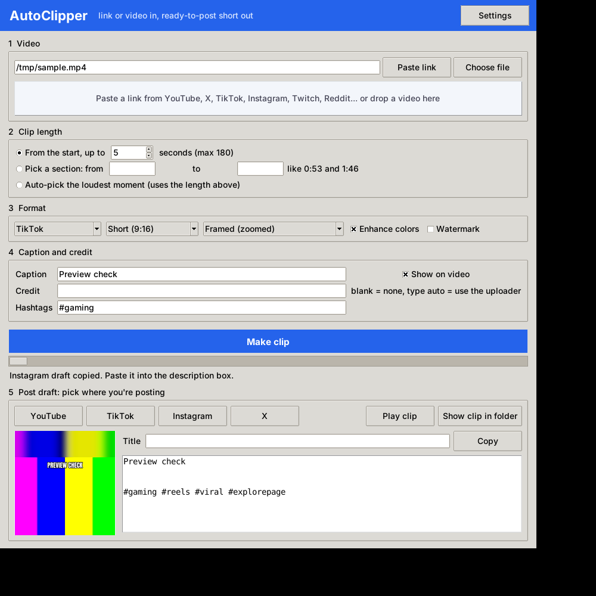

<div align="center">

# AutoClipper

**Turn any video link into a ready-to-post short**

Paste a link or drop a video. Pick a platform. Get a clip and a post draft for YouTube, TikTok, Instagram and X.


<br>

<a href="../../releases/latest"></a>

</div>

> [!IMPORTANT]
> **It never posts for you.** AutoClipper makes the clip and copies the draft. You paste it and publish it yourself.

## Download

No Python, no terminal, no setup. Click the button above, open **AutoClipper.exe** and go. ffmpeg and the downloader are built in.

> [!WARNING]
> The app is not code signed yet, so Windows may show a warning on first launch. Choose **More info**, then **Run anyway**.

## What it looks like



## How it works

1. **Add a video.** Paste a link (YouTube, X, TikTok, Instagram, Twitch, Reddit and more) or drag in a file.
2. **Choose the clip.** Pick a platform preset, or set the length and format yourself.
3. **Make clip.** Add a caption, optional credit and hashtags, then click **Make clip**.
4. **Copy the draft.** Click YouTube, TikTok, Instagram or X. The title, description and hashtags are copied, ready to paste.

## Features

| | |
|---|---|
| **Any link or file** | Paste a social link or drop an mp4 |
| **Presets** | YouTube Shorts, TikTok, Instagram Reels, X and YouTube video |
| **Shorts or widescreen** | 9:16 (1080x1920) or 16:9 (1920x1080) |
| **Three Short styles** | Framed, full video over blur, or fill the screen |
| **Clip length** | Whole video up to N seconds, a section you pick, or the loudest moment |
| **Preview** | Thumbnail and one-click play before you post |
| **Post drafts** | Title, description and viral hashtags for each platform, copied for you |
| **Watermark** | Your text or logo on every clip |
| **Enhance colors** | One tick for punchier video |

## Settings

Open **Settings** to set the save folder, a watermark (text or logo image) and your default hashtags.

### Private or adult-flagged posts

Some posts only download when you are signed in. In Settings, choose the browser you are signed in with (Firefox works best) or point to a `cookies.txt` file. A cookies file is a login key to your account, so keep it private.

## Good to know

- Clips are limited to 180 seconds.
- You are responsible for having the right to reuse any video you download. Credit creators when you can.
- If a link stops working, download the newest release. Sites change often and each release bundles a current downloader.

## For developers

```bash
pip install -r requirements.txt pytest pyinstaller
python run.py          # run from source
python -m pytest       # tests
python build.py        # build dist/AutoClipper.exe (on Windows)
```

Python and tkinter, with yt-dlp, ffmpeg (via imageio-ffmpeg) and Pillow. Pushing a tag like `v0.1.0` builds the exe on GitHub Actions and attaches it to a release.
